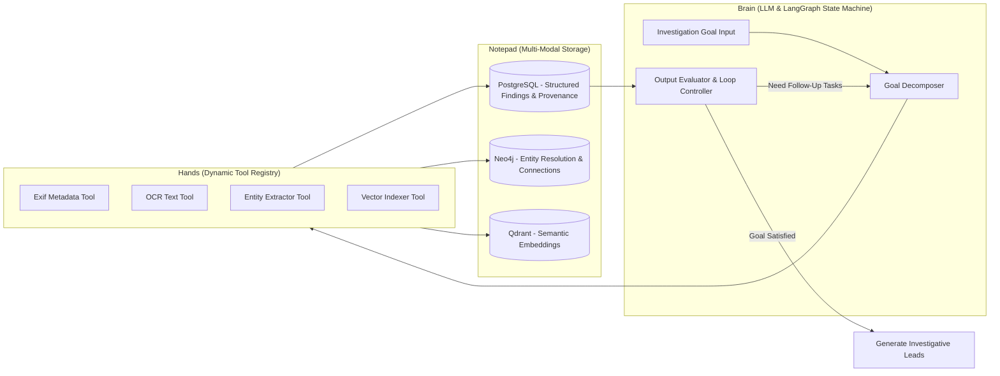
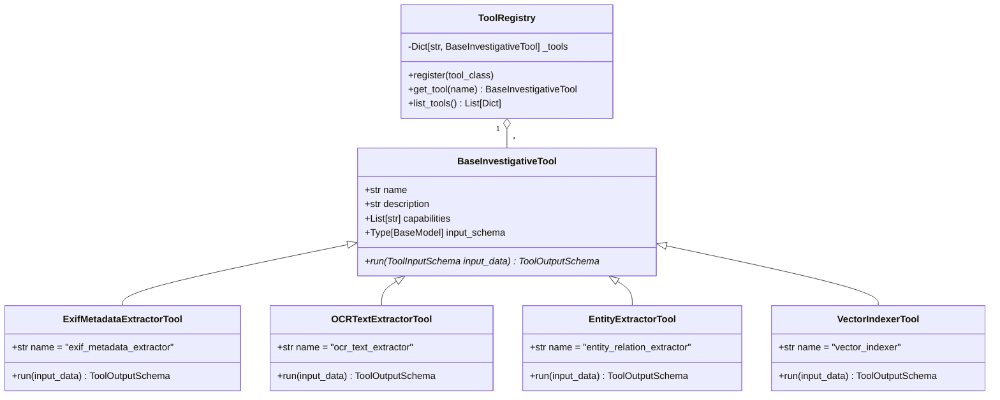
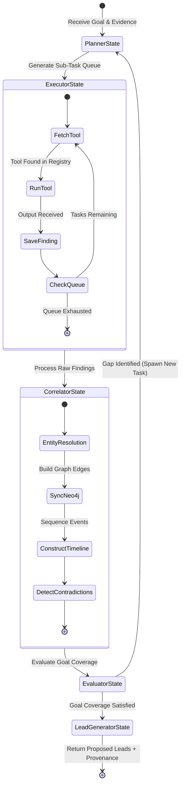

# ARGUS Agent & Tool Architecture

**Document Version**: 1.0.0  
**Core Design Principle**: `Brain, Hands, Notepad` Architectural Pattern

---

## 1. The Brain, Hands, Notepad Paradigm

ARGUS structures its agentic workflow into three decoupled operational layers:

- **Brain (Planning & Reasoning)**: Powered by LangGraph and configurable LLM providers (OpenAI, Anthropic, Ollama, Gemini). The Brain understands the investigator's overall goal, breaks it down into sub-tasks, selects tools, evaluates outputs, and synthesizes leads.
- **Hands (Modular Tool Registry)**: Isolated, single-purpose investigative execution modules (e.g. Exif Extractor, OCR Engine, Entity Extractor, Vector Indexer).
- **Notepad (Persistent Memory)**: Structured state storage combining PostgreSQL (relational evidence & findings), Neo4j (graph entities & relations), and Qdrant (semantic vector search).

---

## 2. Dynamic Tool Registry Architecture

To prevent hardcoding the orchestrator around a fixed list of tools, ARGUS implements an **Open-Closed Decorator-Based Registry**.

New tools implement `BaseInvestigativeTool` and register via the `@register_tool()` decorator. The orchestrator inspects `tool_registry.list_tools()` dynamically at runtime.

---

## 3. LangGraph Orchestrator State Machine

The orchestration engine uses LangGraph's `StateGraph` operating on a `CaseState` Pydantic model.

---

## 4. Initial Modular Tools Specification

| Tool Name | Class Name | Input Data | Output Data | Capabilities |
| :--- | :--- | :--- | :--- | :--- |
| `exif_metadata_extractor` | `ExifMetadataExtractorTool` | Image / file path | EXIF tags, GPS latitude/longitude, camera model, creation timestamp | `metadata`, `gps`, `device_id` |
| `ocr_text_extractor` | `OCRTextExtractorTool` | Image file path | Extracted visible text, sign text, handles in images | `ocr`, `image_text_extraction` |
| `entity_relation_extractor` | `EntityExtractorTool` | Text string / transcript | Extracted handles (`@user`), phone numbers, emails, IP addresses, crypto wallets | `entity_extraction`, `handle_detection` |
| `vector_indexer` | `VectorIndexerTool` | Text chunk | 384-d normalized vector point upserted to Qdrant | `vector_embedding`, `qdrant_storage` |

---

## 5. Dynamic Task Re-planning & Evaluation Loop

When intermediate tools produce new findings (e.g. `OCRTextExtractorTool` discovers a previously unknown handle `@NightOwl` inside a screenshot), the **Task Evaluator Node**:

1. Analyzes extracted entity types against the overall case goal.
2. Identifies new evidence leads or gaps (e.g., "Handle @NightOwl discovered in OCR text; check for matching emails or handles across other chat logs").
3. Appends a new `TaskStep` to `state.tasks` targeting the `entity_relation_extractor` tool.
4. Loop continues until all evidence assets are fully correlated and no new sub-tasks are created.
