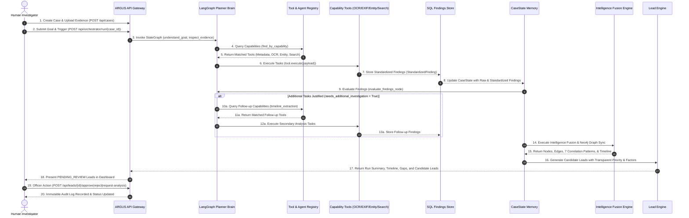

# ARGUS Agentic Investigation Workflow & Verification

This document provides architectural documentation and empirical verification of the **ARGUS (Agentic Investigation Backbone)** workflow. ARGUS is a goal-driven, multi-agent orchestration framework designed for child-protection and digital forensic cyber investigations.

---

## 📐 End-to-End Agentic Sequence Diagram

---

## 🔍 Agentic Capability Verification Matrix

| # | Verification Criteria | Status | ARGUS Backend Implementation & Verification Details |
| :--- | :--- | :--- | :--- |
| **1** | **Investigator Provides Goal** | **VERIFIED** | Goal prompt captured via `POST /api/cases/{case_id}/goals` or orchestration request, ingested into `CaseState.investigation_goal` and parsed by `understand_goal_node` in [`planner.py`](file:///c:/Users/savar/Desktop/ARGUS/backend/app/orchestrator/planner.py#L6-L17). |
| **2** | **Planner Decomposes Goal** | **VERIFIED** | `plan_tasks_node` in [`planner.py`](file:///c:/Users/savar/Desktop/ARGUS/backend/app/orchestrator/planner.py#L32-L91) inspects uploaded evidence types and dynamically breaks down the goal into distinct `TaskStep` objectives. |
| **3** | **Registry Dynamically Selects Capabilities** | **VERIFIED** | Capabilities are dynamically matched via `tool_registry.find_by_capability(capability, input_type)` in [`registry.py`](file:///c:/Users/savar/Desktop/ARGUS/backend/app/tools/registry.py#L42-L80) without hardcoded tool invocations. |
| **4** | **Tools Execute Real Analysis** | **VERIFIED** | Real Python extractors execute analysis: `TextEntityExtractor` (regex handles/phones/IPs), `MetadataExtractor` (Pillow EXIF GPS), `OCRTool` (text extraction), `TimelineExtractor`, and `EvidenceSearchTool` (vector search). |
| **5** | **Findings Persisted** | **VERIFIED** | `store_findings_node` in [`executor.py`](file:///c:/Users/savar/Desktop/ARGUS/backend/app/orchestrator/executor.py#L45-L80) persists standardized findings to PostgreSQL/SQLite `findings` table. |
| **6** | **Findings Evaluated** | **VERIFIED** | `evaluate_findings_node` in [`planner.py`](file:///c:/Users/savar/Desktop/ARGUS/backend/app/orchestrator/planner.py#L93-L124) inspects extracted text/entities against target goals and sets `state.needs_additional_investigation`. |
| **7** | **New Tasks Generated When Justified** | **VERIFIED** | LangGraph conditional edge `should_continue` in [`brain_graph.py`](file:///c:/Users/savar/Desktop/ARGUS/backend/app/orchestrator/brain_graph.py#L18-L32) routes to `plan_additional_tasks_node` when justified to execute follow-up timeline extraction. |
| **8** | **Cross-Source Correlation Occurs** | **VERIFIED** | `IntelligenceFusionService` in [`fusion_service.py`](file:///c:/Users/savar/Desktop/ARGUS/backend/app/correlation/fusion_service.py#L12-L240) evaluates 7 cross-evidence correlation patterns across chats, calls, GPS, images, and reports. |
| **9** | **Knowledge Graph Updated** | **VERIFIED** | `KnowledgeGraphBuilder.sync_to_neo4j` in [`graph_builder.py`](file:///c:/Users/savar/Desktop/ARGUS/backend/app/knowledge_graph/graph_builder.py#L35-L70) creates canonical nodes (`Case`, `Person`, `Account`, `Device`, `Location`, `Evidence`, `Event`) and Cypher edges (`USES`, `LOCATED_AT`, `APPEARS_IN`, `MENTIONED_IN`). |
| **10** | **Timeline Reconstructed** | **VERIFIED** | `TimelineEngine.build_timeline` in [`timeline_engine.py`](file:///c:/Users/savar/Desktop/ARGUS/backend/app/evidence/timeline_engine.py#L40-L240) merges multi-source events, detects overlaps/gaps/conflicts, and formats event explanations. |
| **11** | **Evidence Gaps & Contradictions Detected** | **VERIFIED** | `GapContradictionEngine.analyze_case` in [`gap_contradiction_engine.py`](file:///c:/Users/savar/Desktop/ARGUS/backend/app/evidence/gap_contradiction_engine.py#L45-L250) detects referenced missing evidence (`EvidenceGap`), timestamp/attribute conflicts, and incomplete chains. |
| **12** | **Leads Generated with Provenance** | **VERIFIED** | `LeadEngine.generate_leads` in [`lead_engine.py`](file:///c:/Users/savar/Desktop/ARGUS/backend/app/evidence/lead_engine.py#L25-L150) outputs candidate leads with transparent priority (`HIGH`/`MEDIUM`/`LOW`), `reasoning_factors`, citations, and legal disclaimers. |
| **13** | **Human Review Required** | **VERIFIED** | All AI leads default to `PENDING_REVIEW` (`provenance_type: "AI_GENERATED_RECOMMENDATION"`). Consequential actions require explicit human officer decision via `POST /api/leads/{id}/approve`, `/reject`, or `/request-analysis`, recording immutable `AuditEvent` records. |

---

## 🔒 Safety, Integrity, & Legal Non-Guilt Principle

ARGUS is architected strictly as an investigative decision-support aid. Every lead, correlation finding, timeline anomaly, and evidence gap payload contains the mandatory legal disclaimer:

> *"Investigative aid provided for officer/analyst review. Does not constitute a determination of guilt or administrative finding."*

Autonomous system execution is strictly capped to registered tool capabilities. ARGUS **never** automatically approves consequential investigative actions without explicit human officer review.
