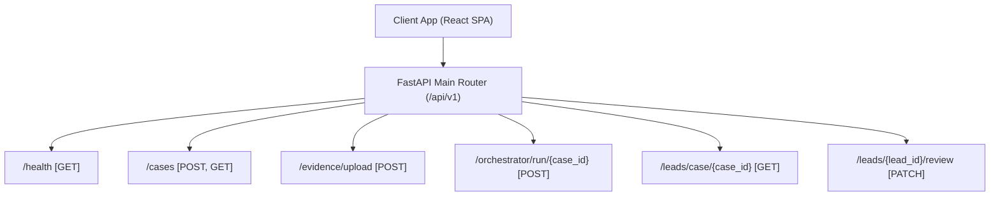

# ARGUS API Contract Specification

**Document Version**: 1.0.0  
**API Base Prefix**: `/api/v1`  
**Format**: JSON over HTTP / RESTful

---

## 1. API Architecture & Routing Diagram



---

## 2. API Endpoint Contracts

### 2.1 System Health & Service Status
**`GET /api/v1/health`**
- **Description**: Returns operational health of backend API, PostgreSQL, Neo4j graph driver, and Qdrant vector client.
- **Response `200 OK`**:
```json
{
  "status": "healthy",
  "service": "ARGUS — Agentic Investigation Backbone",
  "environment": "development",
  "llm_provider": "openai",
  "database": "sqlite_or_postgres_ready",
  "neo4j_connected": true,
  "qdrant_connected": true
}
```

---

### 2.2 Case Management

#### Create New Investigation Case
**`POST /api/v1/cases`**
- **Request Body**:
```json
{
  "case_number": "CASE-2026-0891",
  "title": "Operation Cygnus - Coordinated Online Grooming Network",
  "description": "Multi-modal digital evidence analysis case",
  "investigation_goal": "Identify primary suspect handles, cross-reference geotags, and reconstruct timeline."
}
```
- **Response `201 Created`**:
```json
{
  "id": "c92881a5-8121-4f9e-b9b2-9111ab12ef01",
  "case_number": "CASE-2026-0891",
  "title": "Operation Cygnus - Coordinated Online Grooming Network",
  "description": "Multi-modal digital evidence analysis case",
  "investigation_goal": "Identify primary suspect handles, cross-reference geotags, and reconstruct timeline.",
  "status": "ACTIVE",
  "created_at": "2026-08-13T08:30:00Z",
  "updated_at": "2026-08-13T08:30:00Z"
}
```

#### List All Cases
**`GET /api/v1/cases`**
- **Response `200 OK`**: Array of `CaseResponseSchema` objects.

---

### 2.3 Evidence Ingestion

#### Upload Evidence File
**`POST /api/v1/evidence/upload`**
- **Content-Type**: `multipart/form-data`
- **Form Parameters**:
  - `case_id` (string, required)
  - `file_type` (string, required: `IMAGE` | `CHAT_LOG` | `AUDIO` | `DOCUMENT`)
  - `file` (binary file upload)
- **Response `201 Created`**:
```json
{
  "id": "ev-8812-file-id",
  "case_id": "c92881a5-8121-4f9e-b9b2-9111ab12ef01",
  "file_name": "synthetic_evidence_photo.jpg",
  "file_path": "./data/evidence/ev-8812_synthetic_evidence_photo.jpg",
  "file_type": "IMAGE",
  "mime_type": "image/jpeg",
  "hash_sha256": "e3b0c44298fc1c149afbf4c8996fb92427ae41e4649b934ca495991b7852b855",
  "uploaded_at": "2026-08-13T08:32:00Z"
}
```

---

### 2.4 Brain Pipeline Orchestrator

#### Run Orchestrator Pipeline for Case
**`POST /api/v1/orchestrator/run/{case_id}`**
- **Description**: Triggers the LangGraph Brain pipeline (`Planner` ➔ `Executor` ➔ `Correlator` ➔ `Lead Generator`). Saves findings to Postgres, syncs graph to Neo4j, vectors to Qdrant, and returns proposed leads with execution logs.
- **Response `200 OK`**:
```json
{
  "status": "success",
  "case_id": "c92881a5-8121-4f9e-b9b2-9111ab12ef01",
  "tasks_executed": 4,
  "findings_count": 5,
  "knowledge_graph": {
    "nodes_count": 4,
    "edges_count": 2,
    "nodes": [
      { "id": "handle_cyberhawk", "label": "Handle", "name": "@CyberHawk", "type": "HANDLE" },
      { "id": "loc_37.7749_-122.4194", "label": "Location", "name": "GPS (37.7749, -122.4194)", "type": "LOCATION" }
    ],
    "edges": [
      { "source": "handle_cyberhawk", "target": "handle_nightowl", "relationship": "COMMUNICATED_WITH" }
    ]
  },
  "timeline_events": [
    {
      "timestamp": "2026-08-10 14:00:12",
      "title": "Chat Message Exchanged",
      "description": "@CyberHawk initiated chat sync with @NightOwl",
      "source_evidence": "synthetic_chat_log.txt"
    }
  ],
  "proposed_leads": [
    {
      "id": "lead-9912-uuid",
      "case_id": "c92881a5-8121-4f9e-b9b2-9111ab12ef01",
      "title": "Identify Primary Suspect Handle (@CyberHawk)",
      "summary": "Cross-source evidence correlation identified frequent communication between @CyberHawk and @NightOwl.",
      "status": "PROPOSED",
      "confidence": 0.88,
      "supporting_evidence_ids": ["ev-8812-file-id"],
      "reasoning_chain": [
        "1. Handles extracted from chat log text.",
        "2. Edge COMMUNICATED_WITH established in Neo4j."
      ],
      "next_recommended_actions": [
        "Issue LE preservation request for handle @CyberHawk"
      ]
    }
  ],
  "execution_logs": [
    "Brain Planner initialized. Goal: Identify handles and geotags",
    "Planner generated 4 sub-tasks across 2 evidence files.",
    "Task TASK-001 completed by tool 'exif_metadata_extractor'",
    "Lead Generator produced 1 explainable hypothesis with PROPOSED status."
  ]
}
```

---

### 2.5 Human-in-the-Loop Lead Review

#### Review Lead (Approve / Reject Gate)
**`PATCH /api/v1/leads/{lead_id}/review`**
- **Request Body**:
```json
{
  "action": "APPROVED",
  "reviewer_id": "INV-8821",
  "notes": "Geotag cross-reference verified with cell tower records."
}
```
- **Response `200 OK`**:
```json
{
  "id": "lead-9912-uuid",
  "case_id": "c92881a5-8121-4f9e-b9b2-9111ab12ef01",
  "title": "Identify Primary Suspect Handle (@CyberHawk)",
  "summary": "Cross-source evidence correlation identified frequent communication between @CyberHawk and @NightOwl.",
  "status": "INVESTIGATOR_APPROVED",
  "confidence": 0.88,
  "reviewed_at": "2026-08-13T08:35:00Z",
  "reviewed_by": "INV-8821",
  "reviewer_notes": "Geotag cross-reference verified with cell tower records."
}
```

---

## 3. Error Handling Matrix

| Status Code | Code / Detail | Cause / Resolution |
| :--- | :--- | :--- |
| `400 Bad Request` | `Case number already exists.` | Attempted to create a case with a non-unique `case_number`. |
| `404 Not Found` | `Target case not found.` | Invalid `case_id` provided in request URL or form payload. |
| `422 Unprocessable` | `Validation Error` | Invalid request JSON structure violating Pydantic schema. |
| `500 Internal Error` | `Orchestrator run failed.` | Unhandled internal exception during tool execution or graph sync. |
