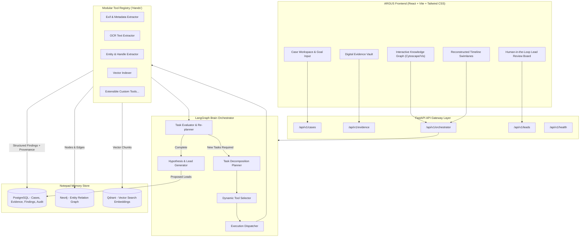
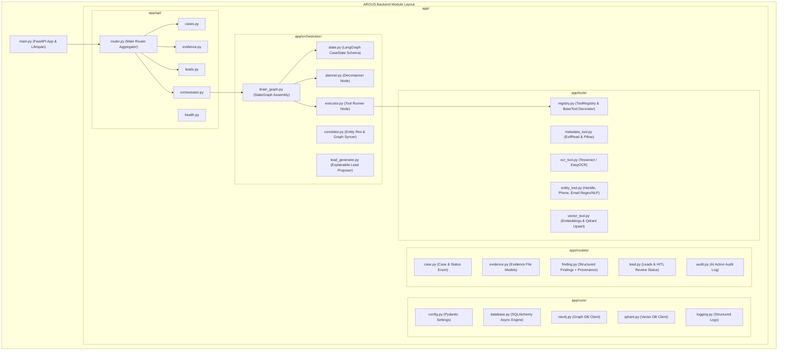
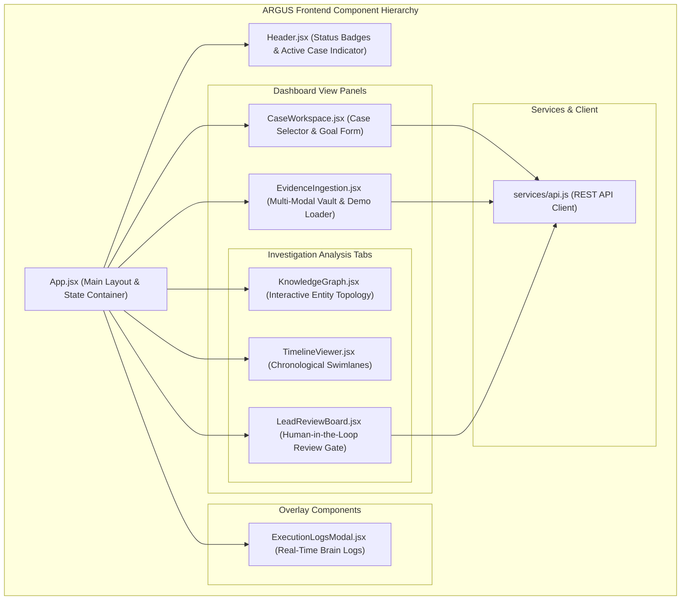
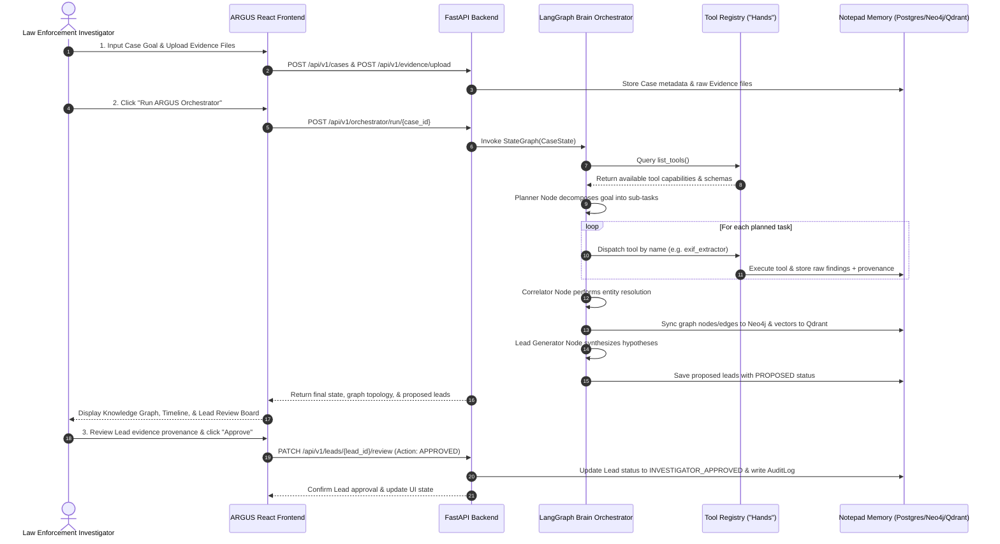

# ARGUS System Architecture

**Project Name**: ARGUS — Agentic Investigation Backbone  
**Document Version**: 1.0.0  
**Core Design Principle**: `ARGUS = Orchestration Backbone + Modular Tools/Agents`

---

## 1. High-Level System Architecture

ARGUS is an agentic investigation support platform designed for law enforcement investigators. It decouples high-level reasoning and planning (the **Brain**) from execution capabilities (the **Hands**) and multi-modal case persistence (the **Notepad**).

---

## 2. Backend Module Structure

The backend is built with Python 3.11+, FastAPI, SQLAlchemy, and LangGraph, organized in a modular structure to enforce clear separation of concerns.

---

## 3. Frontend Module Structure

The frontend is a single-page application (SPA) powered by React 18, Vite, and Tailwind CSS.

---

## 4. End-to-End Investigation Workflow

---

## 5. Security & Human-in-the-Loop Architecture

ARGUS operates under strict security and legal accountability boundaries:

1. **Non-Autonomous Consequential Actions**: ARGUS never makes final determinations of guilt, enforcement action, or target identification. The system generates **Investigative Recommendations** with `PROPOSED` status.
2. **Investigator Approval Gate**: Consequential leads require explicit review by an authorized investigator providing their Badge/Investigator ID and optional justification notes.
3. **Immutable Provenance Trace**: Every finding or proposed lead must retain:
   - `source_evidence_id`
   - `source_tool_name`
   - `confidence_score` (0.0 - 1.0)
   - `reasoning_chain`
   - `timestamp`
   - `case_id`
4. **Audit Trail Logging**: Every AI planning step, tool execution, and investigator decision is written to the `audit_logs` table for court admissibility and internal compliance.
