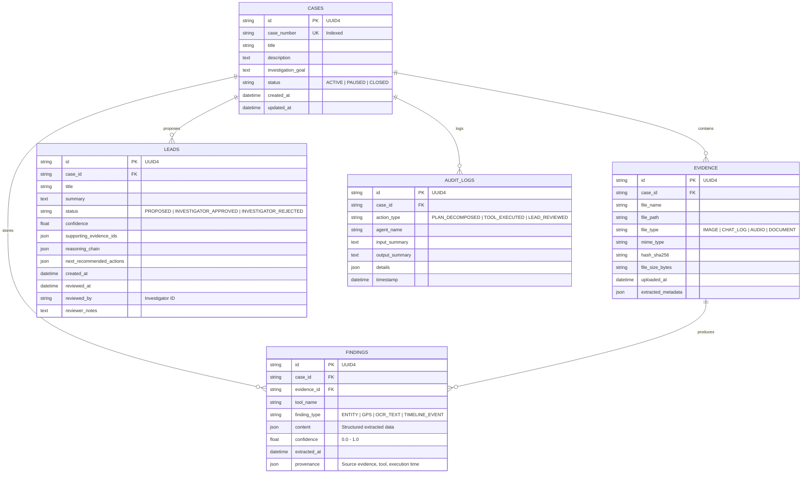
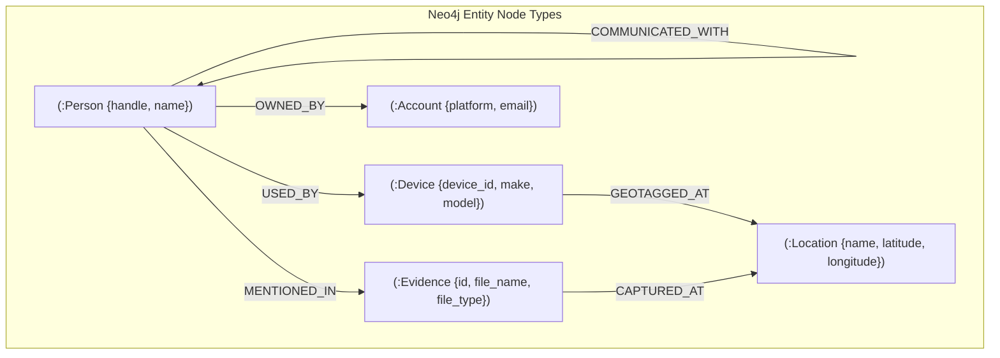

# ARGUS Data Model & Knowledge Graph Schema

**Document Version**: 1.0.0  
**Storage Layers**: PostgreSQL (Relational), Neo4j (Graph), Qdrant (Vector)

---

## 1. Relational Database Schema (PostgreSQL / SQLite)

The relational database manages case metadata, raw evidence references, structured findings with provenance, human-in-the-loop lead decisions, and AI action audit logs.



---

## 2. Knowledge Graph Schema (Neo4j)

The Neo4j graph represents resolved entities and cross-evidence relationship topologies.



### Neo4j Cypher Constraints
```cypher
CREATE CONSTRAINT IF NOT EXISTS FOR (p:Person) REQUIRE p.handle IS UNIQUE;
CREATE CONSTRAINT IF NOT EXISTS FOR (d:Device) REQUIRE d.device_id IS UNIQUE;
CREATE CONSTRAINT IF NOT EXISTS FOR (l:Location) REQUIRE l.name IS UNIQUE;
CREATE CONSTRAINT IF NOT EXISTS FOR (e:Evidence) REQUIRE e.id IS UNIQUE;
```

---

## 3. Vector Database Collection Schema (Qdrant)

The Qdrant collection stores 384-dimensional dense vectors generated from evidence text chunks, OCR output, and document snippets.

### Collection Specs
- **Collection Name**: `argus_evidence_vectors`
- **Vector Dimensions**: `384`
- **Distance Metric**: `Cosine`

### Vector Payload Schema (JSON)
```json
{
  "id": "c7b60e6e-6701-4475-8025-a837e28b17ff",
  "vector": [0.042, -0.118, 0.891, "...(384 floats)"],
  "payload": {
    "case_id": "c92881a5-8121-4f9e-b9b2-9111ab12ef01",
    "evidence_id": "ev-001-chat-log",
    "file_path": "./data/evidence/synthetic_chat_log.txt",
    "text_snippet": "@CyberHawk: Are you ready for the sync? @NightOwl: Yes at meeting location...",
    "source_tool": "ocr_text_extractor"
  }
}
```

---

## 4. Evidence & Finding Data Models (Pydantic / Python)

```python
class ProvenanceModel(BaseModel):
    source_evidence: str
    source_tool: str
    task_id: str
    execution_time_ms: float
    timestamp: datetime = Field(default_factory=datetime.utcnow)

class FindingModel(BaseModel):
    id: str = Field(default_factory=lambda: str(uuid.uuid4()))
    case_id: str
    evidence_id: Optional[str] = None
    tool_name: str
    finding_type: str
    content: Dict[str, Any]
    confidence: float = Field(default=1.0, ge=0.0, le=1.0)
    provenance: ProvenanceModel
```
